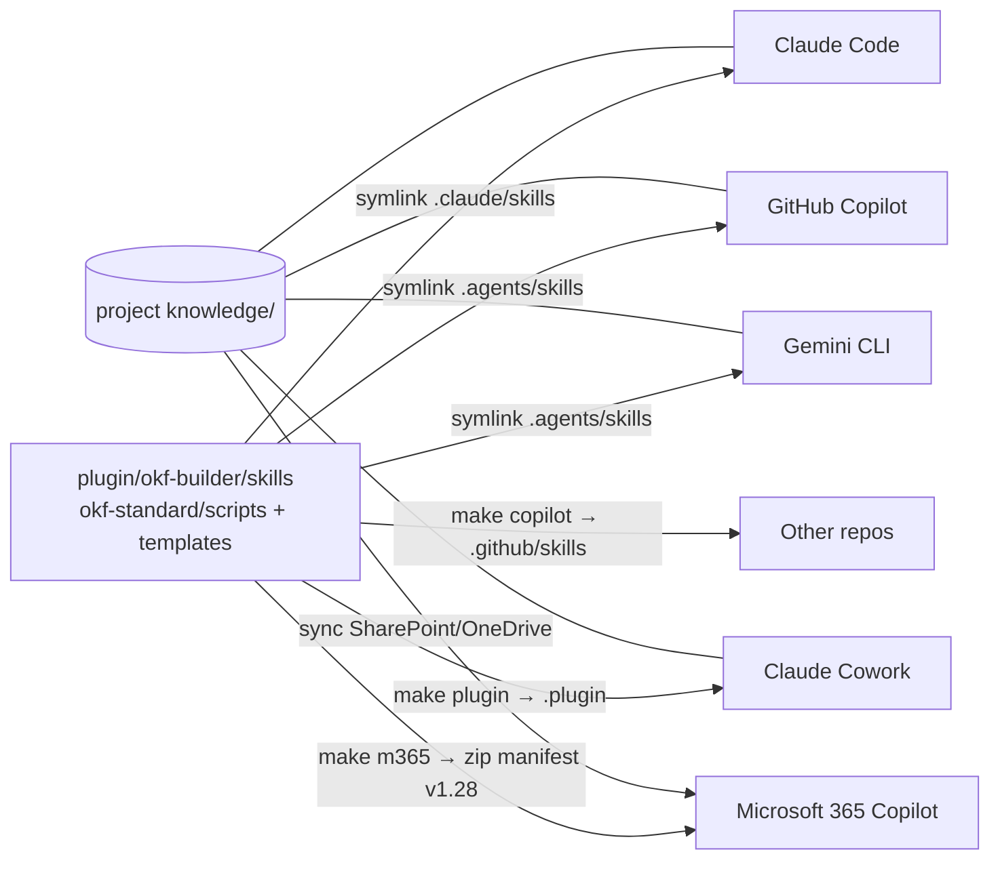

# View

# Elements

| Element | Type | Responsibility | Concept |
|---|---|---|---|
| Source skills | directory | Instructions, templates, scripts | [okf-builder plugin](/systems/plugin-okf-builder.md) |
| Scripts | Python | init, lint, index, migrate | [OKF scripts](/systems/scripts-okf.md) |
| Exporters | Python | Copilot and M365 projections | [Exporters](/systems/exporters.md) |
| Bundle | directory | Project knowledge | — |

# Principles and constraints

- A change is made only in the source; projections are regenerated (`make all`).
- Skills use the `<skills>/` convention; no vendor variable.
- M365: each skill is self-contained, with ≤20 companion files and no hidden files.

# Related decisions

* [ADR-0007](/decisions/ADR-0007-single-source-and-projections.md)
