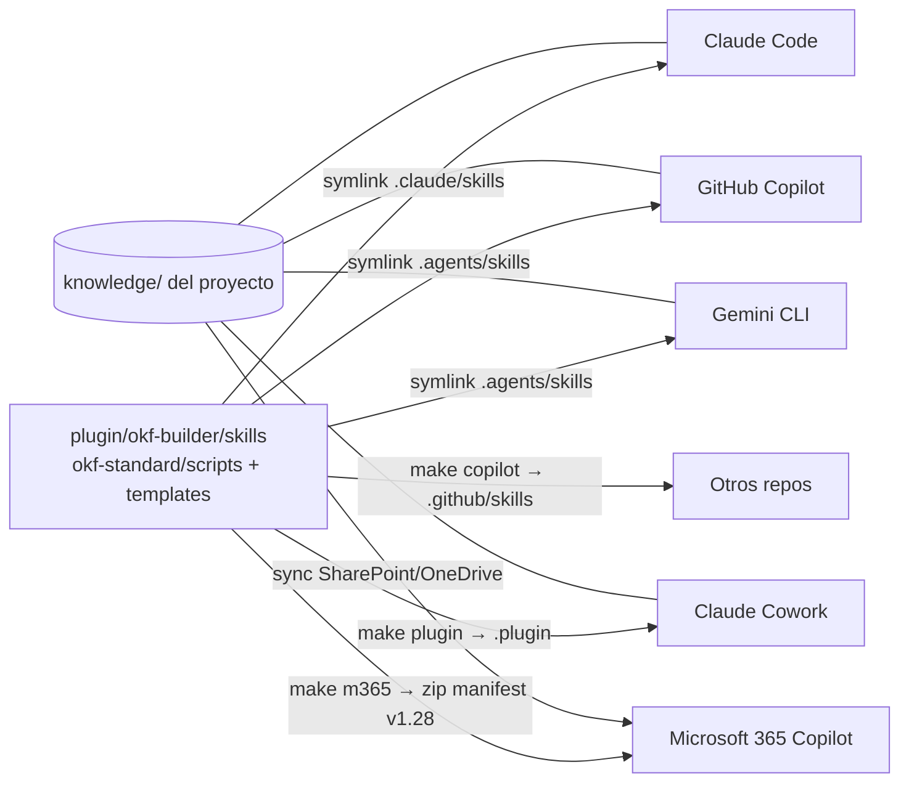

# Vista

# Elementos

| Elemento | Tipo | Responsabilidad | Concepto |
|---|---|---|---|
| Skills fuente | directorio | Instrucciones, plantillas, scripts | [Plugin okf-builder](/systems/plugin-okf-builder.md) |
| Scripts | Python | init, lint, index, migrate | [Scripts OKF](/systems/scripts-okf.md) |
| Exportadores | Python | Proyecciones Copilot y M365 | [Exportadores](/systems/exporters.md) |
| Bundle | directorio | Conocimiento del proyecto | — |

# Principios y restricciones

- Un cambio se hace solo en la fuente; las proyecciones se regeneran (`make all`).
- Los skills usan la convención `<skills>/`; ninguna variable de vendor.
- M365: cada skill autocontenido, ≤20 ficheros companion, sin ficheros ocultos.

# Decisiones relacionadas

* [ADR-0007](/decisions/ADR-0007-single-source-and-projections.md)
